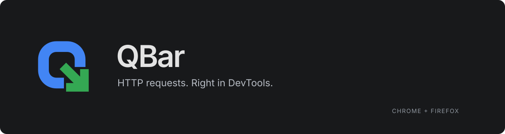
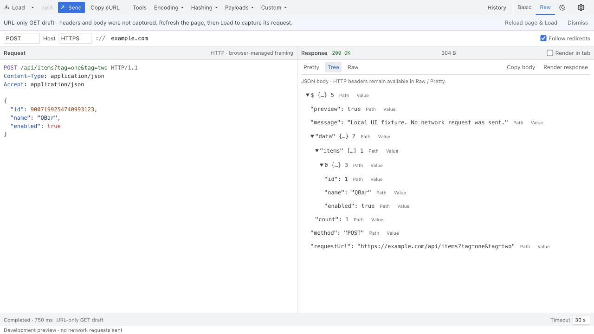

<div align="center">



**浏览器 DevTools 内的轻量 HTTP 请求工具。**

[](https://github.com/Fruit-Guardians/Qbar/actions/workflows/test_build.yaml) 

[安装](#安装) · [使用指南](docs/usage.md) · [开发](docs/development.md) · [问题反馈](https://github.com/Fruit-Guardians/Qbar/issues)

</div>

QBar 运行在 Chrome 和 Firefox 的开发者工具中。读取当前页面请求，修改 URL、请求头和正文，发送后查看响应。需要继续调试时，可以恢复历史请求，或通过 cURL 在工具之间传递请求。

<picture>
  <source media="(prefers-color-scheme: dark)" srcset="docs/assets/panel-dark.jpg" />
  <source media="(prefers-color-scheme: light)" srcset="docs/assets/panel-light.jpg" />
  
</picture>

<sub>开发预览，响应为模拟数据。查看 <a href="docs/assets/panel-light.jpg">浅色</a> / <a href="docs/assets/panel-dark.jpg">深色</a> 截图。</sub>

## 功能

- **请求编辑** — Basic / Raw 双模式，支持常用 HTTP 方法、JSON、表单与 multipart 正文。
- **cURL** — 导入命令或复制当前请求，保留重复字段、请求头及正文内容；导入不执行 shell 命令。
- **响应查看** — Pretty / Tree / Raw JSON 视图，状态码、耗时、大小、正文搜索与复制；支持取消和超时。
- **本地历史** — 按 URL、方法或状态筛选，恢复到编辑器、复制 cURL、删除或暂停记录。
- **内嵌工具侧栏** — 页面请求选择、重复查询参数编辑、无损 JSON 工具、请求/响应对比及 JWT 检查。
- **编辑体验** — Raw HTTP / JSON 语法高亮，保留原生文本编辑；支持跟随系统、浅色与深色主题，实时响应系统外观变化。
- **辅助工具** — JWT 解码与签名校验、编码、哈希；编码、哈希、Payloads 与自定义片段统一收进 Utilities（⋮）。

- **设置与关于** — 工具栏齿轮进入 General / About，在面板内管理偏好并查看项目介绍与版本；支持跟随浏览器语言、简体中文 / English，即时切换并跨面板同步外观。

## 安装

当前源码为 **v0.2.0 开发候选版**，尚未发布；正式安装包以 Releases 页面为准。

从 [Releases](https://github.com/Fruit-Guardians/Qbar/releases/latest) 下载对应浏览器的安装包，无需配置开发环境。请下载 **QBar-chrome.zip** 或 **QBar-firefox.zip**，而不是 GitHub 自动生成的 Source code 压缩包。

**Chrome**

1. 下载并解压 **QBar-chrome.zip**，将文件夹放在固定位置。
2. 打开 `chrome://extensions`，开启**开发者模式**，选择**加载已解压的扩展程序**，加载包含 `manifest.json` 的解压目录。
3. 打开目标网页的 DevTools，切换到 **QBar** 标签。

<details>
<summary>Firefox 安装</summary>

下载并解压 **QBar-firefox.zip**，打开 `about:debugging#/runtime/this-firefox`，选择**临时载入附加组件**并加载解压目录的 `manifest.json`。然后打开网页的 DevTools，切换到 **QBar**。此包未签名，仅供临时加载；临时扩展会在浏览器重启后移除。

</details>

安装后请重新打开已有的 DevTools。找不到标签时，在 `»` 菜单中查找。

每个 Release 提供 `SHA256SUMS.txt`，可核对安装包摘要。需要从源码构建时，见[开发指南](docs/development.md)。

## 使用

1. **Load**：读取当前页面请求，也可从下拉菜单导入 cURL。
2. **Basic / Raw**：编辑 URL、请求头与正文。
3. **Send**：发送请求并查看响应；**Copy cURL** 复制当前请求。
4. **Tools**：选择页面网络请求、编辑查询参数、处理 JSON、对比请求/响应或检查 JWT。
5. **History**：筛选或恢复之前的请求。恢复只填入编辑器，不自动发送。

> 请求通过浏览器网络栈发送，协议协商、Cookie 和部分 cURL 选项与命令行存在差异。历史保存在本地，包含请求头和正文，不保存响应正文。详见[使用指南](docs/usage.md#传输与导入说明)。

## 开发

```sh
yarn dev:ui       # 仅 UI 预览，不发送真实请求
yarn check        # 测试、类型检查与代码规范
yarn build:chrome
yarn build:firefox
```

[开发指南](docs/development.md) · [架构说明](docs/architecture.md) · [更新日志](CHANGELOG.md) · [报告问题](https://github.com/Fruit-Guardians/Qbar/issues/new?template=bug_report.yml) · [功能建议](https://github.com/Fruit-Guardians/Qbar/issues/new?template=feature_request.yml) · [来源与致谢](NOTICE.md)
